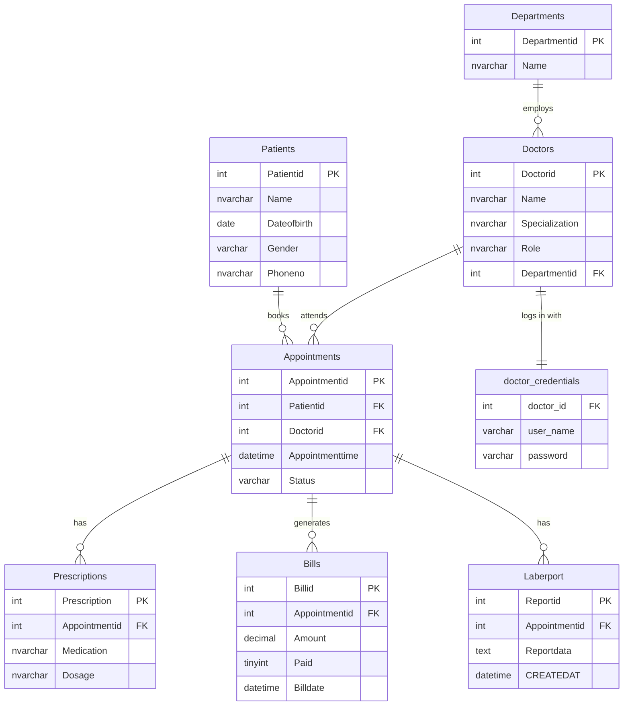
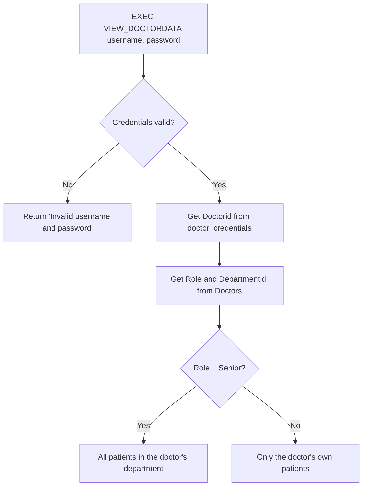

# Hospital Management Database (SQL Server)

A relational database that replaces a hospital's Excel-based record keeping. It covers patients, doctors, departments, appointments, prescriptions, lab reports and billing, and enforces the hospital's business rules directly in the database: scheduling validation, role-based data access, and monthly revenue reporting.


---

## Table of Contents

- [Background](#background)
- [Problems Solved](#problems-solved)
- [Database Design](#database-design)
- [Data Migration](#data-migration)
- [Business Rules](#business-rules)
  - [Appointment validation trigger](#1-appointment-validation-trigger)
  - [Role-based patient access](#2-role-based-patient-access-view_doctordata)
  - [Monthly revenue report](#3-monthly-revenue-report-sp_monthlyrevenue)
- [Getting Started](#getting-started)
- [Project Structure](#project-structure)
- [Known Limitations and Future Improvements](#known-limitations-and-future-improvements)

---

## Background

The hospital managed all of its data in Excel. As operations grew, this became error-prone and hard to manage. This project designs a normalized relational schema from the Excel data, migrates the data into it, and moves the hospital's rules into the database layer.

## Problems Solved

| # | Problem | Solution |
|---|---------|----------|
| 1 | No unique identifiers | `IDENTITY` primary keys on every table |
| 2 | Disconnected relationships | `FOREIGN KEY` constraints between all related tables |
| 3 | Invalid or ambiguous values | `CHECK` constraints on gender and appointment status |
| 4 | Double-booking and past appointments | `AFTER INSERT` trigger that rolls back invalid bookings |
| 5 | Open access to sensitive data | Stored procedure that returns data by login and role |
| 6 | No reporting | Stored procedure for monthly revenue by department |

## Database Design

### Entity relationship diagram



### Tables

| Table | Purpose | Key constraints |
|-------|---------|-----------------|
| `Departments` | Hospital departments (parent table) | PK `Departmentid` |
| `Doctors` | Doctor roster with `Role` (e.g. Senior, Consultant) | FK to `Departments` |
| `Patients` | Patient details | `Gender` must be `m`, `f` or `o` |
| `Appointments` | Links patients and doctors at a time | `Status` must be `Scheduled`, `Completed` or `Cancelled`; FKs to `Patients` and `Doctors` |
| `Prescriptions` | Medication per appointment | FK to `Appointments` |
| `Bills` | Charges per appointment | FK to `Appointments`; `Billdate` defaults to the current time |
| `Laberport` | Lab report data per appointment | FK to `Appointments`; `CreatedAt` defaults to the current time |
| `doctor_credentials` | Username and password for each doctor | Imported from CSV |

## Data Migration

The Excel export is a single wide sheet (about 4,000 rows, 30 columns) with column names such as `Doctors.DoctorID` and `Patients.Name`. It was migrated in two steps:

1. **Stage the raw data.** Import `hospital_data_10000_rows.csv` into a staging table called `hospital_data`. The import wizard turns dots into underscores (`Doctors.DoctorID` becomes `Doctors_DoctorID`).
2. **Load each table in dependency order**, parents before children, with `SET IDENTITY_INSERT ON` so the original IDs are preserved:

```
Departments -> Doctors -> Patients -> Appointments -> Prescriptions -> Bills
```

Each load filters out empty rows (`WHERE <id column> <> ''`). To generate the column list for each `INSERT ... SELECT`, the script builds the `SELECT` from `INFORMATION_SCHEMA.COLUMNS`, filtering on the table prefix (for example `Doctors_%`).

Import `doctor_credentials.csv` separately into the `doctor_credentials` table.

## Business Rules

### 1. Appointment validation trigger

`trg_CheckNewAppointment` runs `AFTER INSERT` on `Appointments` and rolls back the insert when:

| Rule | Error |
|------|-------|
| Appointment time is in the past | `50001: APPOINTMENT CANNOT BE IN THE PAST` |
| The doctor already has a `Scheduled` appointment at the same time | `50002: DOCTOR ALREADY HAS AN APPOINTMENT AT THIS TIME` |

```sql
-- Succeeds
INSERT INTO Appointmnets (Patientid, Doctorid, Appointmenttime, Status)
VALUES (1, 1, '2026-12-15T10:00:00', 'Scheduled');

-- Fails: double booking (run the same insert again)
-- Fails: appointment in the past
INSERT INTO Appointmnets (Patientid, Doctorid, Appointmenttime, Status)
VALUES (1, 1, '2020-01-01T10:00:00', 'Scheduled');
```

### 2. Role-based patient access (`VIEW_DOCTORDATA`)

Doctors log in with a username and password. The procedure finds the doctor's ID from their credentials, looks up their role and department, and returns only what that role allows.



| Role | Can see |
|------|---------|
| Senior | Patient, appointment, medication and lab report data for **every patient in their department** |
| Any other role | The same data, but **only for their own patients** |

```sql
-- Senior doctor
EXEC VIEW_DOCTORDATA '<username>', '<password>';

-- Named parameters also work
EXEC VIEW_DOCTORDATA @INPUT_USERNAME = '<username>', @INPUT_PASSWORD = '<password>';
```

### 3. Monthly revenue report (`SP_MONTHLYREVENUE`)

Returns total billed revenue per department for a given month and year.

```sql
EXEC SP_MONTHLYREVENUE @YEAR = 2024, @MONTH = 9;
```

| Department | TOTAL REVENUE |
|------------|---------------|
| Department 1 | ... |
| Department 2 | ... |

It joins `Bills` -> `Appointments` -> `Doctors` -> `Departments`, filters on `Billdate`, and groups by department name.

## Getting Started

**Requirements:** SQL Server 2016 or later, plus SSMS or Azure Data Studio.

1. Clone the repository.
   ```bash
   git clone https://github.com/<your-username>/<your-repo>.git
   ```
2. Open `SQLQuery1.sql` in SSMS.
3. Run the script in order: create the database and tables, import the CSV files, load the data, then create the trigger and procedures.
4. Import the CSV files with the **Import Flat File** wizard (right-click the database > Tasks > Import Flat File):
   - `hospital_data_10000_rows.csv` into a table named `hospital_data`
   - `doctor_credentials.csv` into a table named `doctor_credentials`
5. Test the procedures with the examples above.

## Project Structure

```
.
├── SQLQuery1.sql                                          # Schema, migration, trigger and procedures
├── hospital_data_10000_rows.csv                           # Source data exported from Excel
├── doctor_credentials.csv                                 # Doctor logins
├── Hospital_Database_Creation_and_Data_Migration_Questons.docx   # Original problem statement
└── README.md
```

## Known Limitations and Future Improvements

- **Plain-text passwords.** `doctor_credentials` stores passwords as text. A production system should store salted hashes (for example with `HASHBYTES` or application-side bcrypt) and should not commit real credentials to a public repository.
- **Naming typos.** The table and column are spelled `Appointmnets` and `Appointmnetid`, and the lab table is created as `Laberport`. Renaming them to `Appointments`, `Appointmentid` and `LabReports` would make the schema cleaner.
- **Trigger timing.** The trigger is `AFTER INSERT` with a rollback. An `INSTEAD OF INSERT` trigger or a unique index on (`Doctorid`, `Appointmenttime`) would be a stronger guard against double booking.
- **Updates are not validated.** The trigger fires on insert only, so rescheduling an appointment through `UPDATE` bypasses the rules.
- **`TEXT` data type.** `Reportdata` uses `TEXT`, which is deprecated. `NVARCHAR(MAX)` is the recommended replacement.
- **No indexes beyond keys.** Indexes on `Appointments(Doctorid, Appointmenttime)` and `Bills(Billdate)` would speed up the trigger and the revenue report.

## License

This project is for learning and demonstration purposes.
